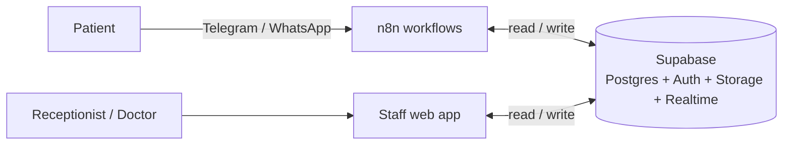

# Smart Clinic

A **multi-tenant clinic management SaaS**: a mobile-first staff app for receptionists and doctors, plus an AI-powered chat bot that lets patients book, cancel, and reschedule appointments and ask about their last visit. Many clinics run on the same platform at the same time, each with fully isolated data and its own monthly subscription plan with a message limit.

> **Live demo:** https://smartclinic-six.vercel.app/auth/staff
> **Status:** MVP complete, bot in a trial phase. Telegram is live; WhatsApp support is in progress.

<!-- TODO: add 2-3 screenshots here (receptionist home, doctor queue, patient file) -->

---

## Why this exists

Small clinics still run on paper, phone calls, and WhatsApp messages. Smart Clinic replaces that with:

- one place where staff see today's queue in real time,
- a bot that handles the repetitive patient conversations 24/7,
- a patient record the doctor reviews *before* writing today's notes,
- a SaaS model: onboard a clinic, give it a plan, and it runs on shared infrastructure without ever seeing another clinic's data.

There is **no patient-facing app**. Patients only talk to the bot; staff only use the web app. Both read and write the same Supabase database.

---

## Architecture



| Layer | Tech |
|---|---|
| Staff app | TypeScript, TanStack Start, Bun |
| Backend | Supabase (Postgres, Auth, Row Level Security, Storage, Realtime) |
| Automation | n8n |
| AI | Google Gemini (message classification + conversational agents) |
| Patient channels | Telegram (live), WhatsApp (in progress) |

The staff app was scaffolded with [Lovable](https://lovable.dev) and then extended by hand.

---

## Multi-clinic (multi-tenant) design

Multiple clinics are served at the same time from one deployment and one database.

- **Clinics table.** Every clinic has a row in `clinics` with a unique `clinic_code`.
- **Tenant column everywhere.** `profiles`, `patients`, `appointments`, `invoices`, `invoice_items`, and `patient_files` all carry a `clinic_id`, which is filled in automatically from the logged-in user's profile.
- **Isolation enforced in the database.** Row Level Security policies only allow access to rows where `clinic_id` matches the current user's clinic, so a bug in the app cannot leak data across clinics.
- **File isolation.** Patient files are stored in a private storage bucket, with each clinic's files under its own folder and storage policies tied to the same rule.
- **Staff onboarding.** A clinic's first doctor is attached to it through the `clinic_code` set when the account is created; every other account is added by a doctor from that clinic and inherits its clinic.
- **Bot isolation.** Each clinic's bot workflow is configured with that clinic's ID. Every database query and every conversation memory key includes it, so patients, bookings, and chat context never mix between clinics.

---

## Subscriptions and message limits

Each clinic is on a **monthly plan with a message limit** (the number of patient messages the bot may handle per day).

Before the bot processes any message, it looks up the clinic's subscription and only continues if:

1. the plan has not expired (`end_date` is today or later), and
2. the clinic is still under its limit (`messages_used < message_limit`).

This keeps AI costs predictable per clinic and makes tiered pricing straightforward: a bigger plan is just a bigger `message_limit` and a later `end_date`.

---

## Staff app

Arabic UI, right-to-left layout, bottom navigation bar (designed for phones and tablets used while moving around the clinic). Clean, calm look: white background, blue accent, rounded cards.

### Authentication
- Single login page at `/auth/staff` (email + password) using Supabase Auth.
- **No public sign-up.** Nobody can create an account for themselves. The first doctor account of each clinic is created by the platform admin; after that, doctors add their own team from inside the app (see *Team management* below).
- After login, the user's `role` is read from the `profiles` table and they are redirected to their own dashboard. If no valid role is found, the user is signed out with an error.

### Receptionist
Tabs: **Home / Patients / Appointments / Invoices / Accounts**

- **Today's appointments** table (patient, time, status). Status dropdown: `waiting`, `with_doctor`, `done`, `cancelled`, `no_show`. Changes apply instantly.
- **Confirm arrival** button: sets the appointment to `waiting` and automatically creates an `unpaid` invoice for the patient.
- **Add patient** (name, phone, date of birth).
- **Walk-in appointment**: book a same-day slot for an existing or new patient, with an optional reason.
- **Invoices**: search by patient name, filter by period (today, this week, this month, custom range) and by payment status. Each invoice holds several service line items with prices and a running total; edit, save, or mark as paid.
- **Accounts**: revenue and patient-count overview for the selected period.
- **Patient search** by name or phone, with basic info and appointment history.

### Doctor
Tabs: **Today's Queue / Patients / Accounts / Team**

- **Live queue** in appointment order, with the current patient highlighted at the top. Updates in real time when the receptionist changes a status.
- **Patient file** (`/doctor/patient/:id`) in a deliberate order:
  1. Basic info
  2. **Medical history**: timeline of past visits (date + doctor's notes), most recent first
  3. **Today's visit**: notes, diagnosis, and treatment plan, with a save button

  History comes *before* the notes box so the doctor reviews the past before writing a new diagnosis.
- **Medical report**: download the patient's visit history (diagnosis, treatment plan, notes) as a PDF.
- **Patient files**: documents and images attached to the patient record, stored per clinic.
- **Accounts**: the same revenue overview the receptionist sees.
- **Patient search** by name or phone.

### Team management (doctor only)
Doctors manage their own clinic's staff from the **Team** tab: see everyone on the clinic team, and add a new member with full name, email, a temporary password, and a role (receptionist or doctor). This is the only way accounts are created, and it is available to doctors only, so a clinic can onboard its own receptionists and additional doctors without contacting the platform admin. New members always belong to the creating doctor's clinic.

---

## Patient bot (n8n)
Workflow files live in [`/clinic`](./clinic).
### 1. Chat assistant (`My Smart Clinic`)

```
Telegram message
   -> attach clinic context
   -> check clinic subscription (not expired, under message limit)
   -> AI classifier  (order | cancel | reschedule | followup | questions | general)
   -> specialised AI agent for that intent
   -> reply to the patient
```

Each agent has its own instructions and only the database tools it needs:

| Intent | What the bot does |
|---|---|
| **order** | Collects name, phone, date, and time. Finds or creates the patient, checks the slot is free, then books. Enforces working hours and a same-day booking cutoff. Asks for AM/PM when a time is ambiguous. |
| **cancel** | Finds the patient's upcoming `waiting` appointment and cancels it. |
| **reschedule** | Moves an existing appointment to a new free slot. |
| **followup** | Identifies the patient by chat ID and relays the date, reason, and doctor's notes of their latest visit **word for word**. It never interprets results or gives medical advice. |
| **questions / general** | Answers clinic questions and greetings. |

Design choices worth noting:
- A classifier first, then focused agents, keeps each prompt short and predictable.
- Conversation memory is keyed per clinic and per chat, so context is never mixed between patients or clinics.
- The follow-up agent is deliberately restricted to recorded facts; when something is missing it says so and hands off to staff.

### 2. Daily reminders (`Clinic-Alert Bot Handler`)

Runs every day at 08:00 (Africa/Cairo):

1. Fetch today's `waiting` appointments for the clinic.
2. For each patient with a linked Telegram chat, send a reminder with the appointment time and their expected position in the queue.

---

## Data model

| Table | Purpose |
|---|---|
| `clinics` | One row per clinic: name and unique `clinic_code` |
| `subscriptions` | Per-clinic plan: `end_date`, `message_limit`, `messages_used` |
| `profiles` | Staff: full name, role (`receptionist` or `doctor`), clinic |
| `patients` | Name, phone, date of birth, linked Telegram chat |
| `appointments` | Patient, date, time, status, reason, notes, diagnosis, treatment plan |
| `invoices` | Patient, linked appointment, payment status |
| `invoice_items` | Service line items (service + price) belonging to an invoice |
| `patient_files` | Metadata for files attached to a patient (stored in the `patient-files` bucket) |

Security:
- Row Level Security is enabled on every table and scoped by clinic (see the multi-tenant section above).
- Helper functions (`is_staff`, `current_clinic_id`) are `SECURITY DEFINER` with a fixed `search_path`, and their execute permission is revoked from anonymous users.
- A database trigger creates a `profiles` row when an auth user is created, reading `role`, `full_name`, and `clinic_code` from the user metadata.
- Realtime is enabled on `appointments` to power the live doctor queue.

---

## Getting started

**Requirements:** [Bun](https://bun.sh) (or Node.js + npm) and a Supabase project.

```sh
git clone https://github.com/ahmedelsaman283-cloud/smartclinic.git
cd smartclinic
bun install
bun run dev
```

Create a `.env` file in the project root:

```
VITE_SUPABASE_URL=
VITE_SUPABASE_PUBLISHABLE_KEY=
VITE_SUPABASE_PROJECT_ID=
```

Then:

1. Apply the migrations in [`supabase/migrations`](./supabase/migrations) in order, and create a private storage bucket named `patient-files`.
2. Create a row in `clinics` for your clinic, and a matching row in `subscriptions` to activate the bot.
3. Create the clinic's first doctor in the Supabase dashboard (Authentication -> Users) with `role` set to `doctor`, plus `full_name` and `clinic_code` in the user metadata. That doctor adds everyone else from the Team tab.
4. Open the app and sign in at `/auth/staff`.

To run the bot, import the two workflows from `/clinic` into n8n and connect your own Supabase, Telegram, and Gemini credentials. Set the clinic ID in the workflows to your clinic's ID.

---

## Roadmap

- [ ] WhatsApp channel for the bot
- [ ] Self-service onboarding for new clinics
- [ ] Admin panel to manage clinics, plans, and usage
- [ ] Reporting dashboard (daily visits, revenue)

---

## Author

Built by **Ahmed Elsaman Ahmed**, AI automation engineer (n8n, AI agents, SaaS).
<!-- TODO: add LinkedIn / email -->
